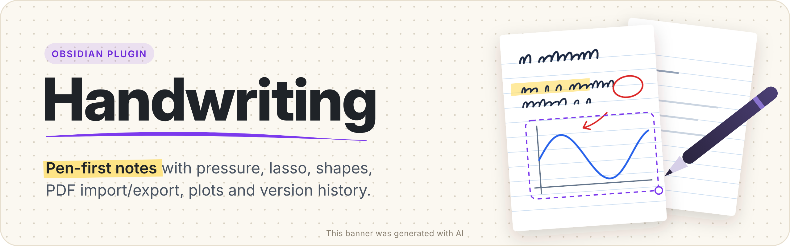

<p align="center"></p>

# Handwriting

> [!WARNING]
> **AI Notice!** This project is entirely vibe-coded using Claude Code.

Write by hand in Obsidian. Pen pressure, highlighter, shapes, lasso selection, images, imported PDFs, function plots,
a calculator, version history and a PDF export – in notes that stay readable even without Obsidian.

> Made for pen tablets and touch-screen laptops (Surface, OLED convertibles, iPad, Android tablets),
> and it also works with a mouse.

<!-- Screenshots: add images to /docs and link them here, e.g.  -->

---

## Contents

- [Getting started](#getting-started)
- [Writing tools](#writing-tools)
- [Selection (lasso)](#selection-lasso)
- [Moving around: scroll, zoom, minimap](#moving-around-scroll-zoom-minimap)
- [Pages: add, reorder, size, pattern, paper](#pages)
- [Contents – page titles](#contents--page-titles)
- [Images, screenshots and PDFs](#images-screenshots-and-pdfs)
- [Calculator and function plots](#calculator-and-function-plots)
- [Export to PDF](#export-to-pdf)
- [Printing](#printing)
- [Version history](#version-history)
- [Where your data lives](#where-your-data-lives)
- [PDF without Obsidian – `hnote2pdf.py`](#pdf-without-obsidian--hnote2pdfpy)
- [Toolbar and the ⋯ menu](#toolbar-and-the--menu)
- [Pen, touch and palm rejection](#pen-touch-and-palm-rejection)
- [OLED care](#oled-care)
- [Commands](#commands)
- [Keyboard shortcuts](#keyboard-shortcuts)
- [Settings overview](#settings-overview)
- [Installation](#installation)
- [Privacy, network and desktop-only features](#privacy-network-and-desktop-only-features)
- [For developers](#for-developers)

---

## Getting started

1. **New note:** right-click a folder in the file explorer → **New handwritten note**, or run the command
   *Create new handwritten note*. The note gets a name built from the folder and today's date (configurable).
2. **Write** with the pen (or mouse). Fingers scroll and zoom, the pen draws.
3. Everything saves automatically. Notes are `.hnote` files – plain JSON.

## Writing tools

| Tool | What it does |
|---|---|
| **Pen** | Pressure-sensitive ink. Three thicknesses, a colour palette and opacity (100 / 75 / 50 / 25 %). Jitter from the pen is smoothed out, but sharp corners stay sharp. |
| **Highlighter** | Transparent marker with flat ends – like a real highlighter. Overlapping strokes don't get darker. Highlight several lines in one zig-zag movement: the turns stay square. |
| **Eraser** | Cuts strokes where you rub (it doesn't paint white). Its size on screen is the same at every zoom level; rub quickly and it grows up to 4×. The pen's eraser end and side button work too. |
| **Shapes** | Line (optionally an arrow), rectangle, ellipse; solid, dashed, dotted or dash-dot; filled or outlined. Hold **Shift** for straight angles / squares / circles. |
| **Lasso** | Select, move, scale, rotate, recolour, group and lock. Tap the lasso button again to switch between freehand lasso and rectangle selection. |

The colour / thickness button opens the style panel. On narrow screens colours, thickness and opacity share one panel.

## Selection (lasso)

- **Draw around** strokes and images to select them; **tap** a stroke or image to select it (with its whole group).
- **Drag** the selection to move it – also onto another page. **Corner handle**: scale. **Round handle**: rotate (Shift = 15° steps).
- With a selection active, the palette and thickness change the **selected strokes**.
- **Selection options** (button on the toolbar or right-click on the selection): group / ungroup, lock, bring to front /
  send to back, align, rotate 90°, duplicate, copy, cut, delete.
- Locked items can't be selected, moved or erased – right-click the page → *Unlock*.

## Moving around: scroll, zoom, minimap

- **Fingers / trackpad:** one finger scrolls (with inertia), two fingers pinch-zoom. **Mouse:** wheel scrolls, Ctrl + wheel zooms.
- **Zoom button** (shows the current zoom, e.g. *135%*): − / + in 10 % steps, *Fit width*, *100%*,
  and up to four **favourite zoom levels** – save the zoom you like to write at with *+ Save*, one tap brings it back.
  *Open notes at …* makes every note open at that zoom (otherwise each note keeps the zoom you last used in it).
- Notes remember **where you stopped** and open at that place.
- **Minimap** – page thumbnails at the edge. *Slim rail* expands when touched or hovered; *Panel* is always visible.
  Tap or drag it to jump. Pages with a title are marked with a corner flag.
- On a very narrow window the toolbar scrolls sideways (finger, mouse wheel or the ‹ › arrows).

## Pages

Open **⋯ → Pages and style…** (or right-click a page).

- **Pages tab:** add, delete and reorder pages (drag the handle or type a position).
- **Page style tab** – for one page or for all pages (and new pages) of the note:
  - **Page size:** *A4 portrait*, *A4 landscape*, or *Endless* – a page that grows downwards as you write
    (half a page at a time, up to 16 A4 pages).
  - **Pattern:** dots, lines, grid (5 mm), blank, Cornell, isometric, lines + margin, checklist, millimetre paper, music staff.
  - **Paper colour:** presets or any colour.
- Right-click (or long-press) a page for quick actions: add page before / after, move, delete, paste, page style, page title.

## Contents – page titles

Give important pages a title: right-click a page → **Page title…**, or the command *Set title of the current page*.

- The **Contents** button on the toolbar lists titled pages; tap one to jump there.
- **Go to page…** (command or the Contents panel) searches titles and page numbers.
- Titles become **bookmarks** in exported PDFs.

## Images, screenshots and PDFs

- **Paste** (Ctrl+V), **drag & drop**, or **⋯ → Insert image…**. Images can be moved, scaled, rotated and cropped
  (right-click the image → *Crop image…*).
- **Screenshot** (Windows): starts the Snipping Tool and inserts the capture automatically.
- **Import PDF:** each PDF page becomes a page of the note with the PDF as its background – write on lecture slides,
  worksheets or papers. Landscape PDF pages become landscape note pages. Uses the PDF engine built into Obsidian (offline).

## Calculator and function plots

- **Calculator** (toolbar button or command): a compact *Basic* tab, and a *Scientific* tab with complex numbers,
  matrices, integrals, derivatives, equation solving and a unit converter. Click a result to copy it.
- **Function plot** (⋯ menu or command): plot functions, parametric and polar curves, or data points with a fitted curve.
  Options include *One period* for periodic functions, π-based axis ticks, a clean style without a grid, and size presets.
  Plots are inserted as images and stay **editable** (right-click → *Edit plot*).

## Export to PDF

**⋯ → Export to PDF.** Choose where to save it each time, or set a default (next to the note, a vault folder, or – on
desktop – a folder on your computer). Page sizes, patterns, images and PDF backgrounds are kept; page titles become
bookmarks. Resolution: Settings → Files and export.

## Printing

**⋯ → Print…** (or the *Print current note* command, or a toolbar shortcut). On desktop the system print dialog opens
with one sheet per page: A4 portrait or landscape as in the note, endless pages cut into A4 sheets. Pick the printer,
page range and copies there. On phones and tablets plugins can't open a print dialog, so the note is exported to PDF
and you print it from your PDF viewer (Share → Print).

## Version history

Versions of every note are saved automatically: while you work (at most every N minutes), when you close the note,
before pages are deleted and before an older version is restored. The same content is never stored twice, and empty
notes are not stored at all.

**⋯ → Version history…** shows the versions by day with a page preview. You can **restore** a version (the current state is
kept, so you can undo the restore), **open it as a copy**, **save a version now**, or **delete** single versions
or all of them (each delete needs a second click). The last 24 hours keep every version; older days keep the last one
of each day. Retention time and a size limit per note are in Settings → Version history.

## Where your data lives

```
Lectures/Physics/Lecture 1.hnote                  ← the note (JSON)
Lectures/Physics/.Lecture 1.hnote-data/           ← hidden folder of this note
    attachments/        images, plots, imported PDF pages used by the note
    history/            versions (gzip) + history/attachments (images only old versions use)
    meta.json
```

- The hidden folder **moves, renames and deletes together with the note**. The note plus its folder contain everything.
- Images that the note no longer uses are moved to `history/attachments` (old versions still show them) and removed when
  no version needs them anymore.
- Prefer Obsidian's attachment folder? Settings → Files and export → *Where to keep pasted images and PDF pages*.
  Note: some sync services (e.g. Obsidian Sync) skip hidden folders.

## PDF without Obsidian – `hnote2pdf.py`

A small Python script turns `.hnote` notes into vector PDFs on any computer – no Obsidian, no plugin, no extra packages
(Python 3.8+; Pillow optional for faster PNGs and WebP/GIF images).

1. Settings → Files and export → **Save hnote2pdf.py** (it is written to the root of your vault), or use the command
   *Copy command to convert this note to PDF with Python* – it copies a ready-to-paste terminal command.
2. Run it:

```bash
python3 hnote2pdf.py "Lectures/Physics/Lecture 1.hnote"          # → Lecture 1.pdf next to the note
python3 hnote2pdf.py "Lecture 1.hnote" -o ~/Desktop/lecture.pdf
python3 hnote2pdf.py MyVault -r -o ~/PDF/                         # every note in a folder, recursively
python3 hnote2pdf.py ".Lecture 1.hnote-data/history/20261019-212953_0f315cad_auto.hnote.gz"   # an old version
```

Options: `--no-pattern` (plain paper), `--pressure 0.7` / `--no-pressure`, `--vault PATH`.
The file format is documented at the top of the script.

## Toolbar and the ⋯ menu

Settings → **Toolbar** decides what sits on the toolbar:

- **Tools** – eraser, highlighter, lasso, shapes, undo/redo. The pen and the colour / thickness button always stay.
- **Shortcut buttons** – calculator, zoom, contents, function plot, insert image, pages and style, screenshot,
  import / export PDF, version history, fit to width.

Anything not on the toolbar is in the **⋯ menu** – nothing appears twice. The ⋯ menu also has quick switches
(minimap, pen pressure, palm rejection) and *Settings*.

## Pen, touch and palm rejection

- **Pen pressure** on/off and strength.
- **Palm rejection:** *Auto* ignores touch while the pen is near the screen or just after it was used, and ignores
  large contacts. *Strict* – fingers never scroll (pen only).
- **Pinch to zoom** – two fingers zoom as soon as they clearly move apart / together (also with one finger held still);
  two contacts moving together (a sliding hand) only scroll, three or more contacts (a resting hand) do nothing, and
  fingers are ignored while the pen is at the screen. Turn it off completely if you prefer.
- **Long-press menu** – hold a finger still to open the page menu (turn it off if a resting hand triggers it).
- **Pen side button:** page menu, undo, redo, Snipping Tool (Windows) or nothing.

## OLED care

Settings → **OLED care** – each option on its own:

- **Dark paper on screen** – light pages are shown dark with light ink (colours keep their hue). Display only: files and
  exports are unchanged.
- **Fade the toolbar while writing** – toolbar and minimap fade and come back when the pen or cursor gets close.
- **Pixel shift** – the view moves by 1–2 px every few minutes.
- **Dim when idle** – after 1–30 minutes without input the note dims almost to black; the first tap only wakes it.

## Commands

| Command | |
|---|---|
| Create new handwritten note | |
| Open calculator | |
| Insert function plot into handwritten note | |
| Export current note to PDF / Print current note | |
| Show version history of the current note / Save a version of the current note now | |
| Go to page… (search page titles) / Set title of the current page | |
| Zoom to favourite zoom (repeat to cycle) / Save current zoom as favourite | |
| Move images of the current note into its hidden folder | for notes created before the hidden folder existed |
| Remove unused images from the current note's hidden folder | |
| Save the PDF converter script / Copy command to convert this note to PDF with Python | |

## Keyboard shortcuts

| Keys | |
|---|---|
| Ctrl/Cmd + Z, Ctrl/Cmd + Y | undo, redo |
| Ctrl/Cmd + C / X / V | copy / cut / paste the selection or an image |
| Delete / Backspace | delete the selection |
| Escape | clear the selection |
| Ctrl/Cmd + mouse wheel | zoom |
| Shift while drawing a shape / rotating | straight angles, squares, circles / 15° steps |

## Settings overview

| Section | What you can set |
|---|---|
| Pen and touch | pressure, palm rejection, pinch to zoom, long-press menu, pen side button, eraser behaviour on highlighter and shapes, default selection mode |
| Colors | five quick colours for the pen and for the highlighter |
| Pages and view | default page pattern and paper colour, favourite zoom levels, zoom when opening a note, minimap |
| Toolbar | tools and shortcut buttons on the toolbar (the rest goes to ⋯) |
| Files and export | where images are stored, the Python converter, new-note naming, PDF export location and resolution |
| Version history | on/off, interval, how long to keep versions, space limit per note |
| Performance | canvas sharpness (lower = smoother on slow devices) |
| OLED care | dark paper, fading toolbar, pixel shift, dim when idle |
| Advanced | debug logging (developer console) |

## Installation

**From Community plugins** (after it's published): Settings → Community plugins → Browse → search *Handwriting* → Install → Enable.

**Beta via BRAT:** install the *BRAT* plugin → *Add beta plugin* → `<github-user>/<repository>`.

**Manually:** download `main.js`, `manifest.json` and `styles.css` from the latest release into
`<your vault>/.obsidian/plugins/handwriting/`, then enable the plugin in Settings → Community plugins.

## Privacy, network and desktop-only features

- The plugin makes **no network requests** and collects **no telemetry**. PDF import uses the PDF engine bundled with Obsidian.
- **Files outside the vault:** only when you choose a folder on your computer as the PDF export location (desktop only).
- **Desktop-only extras** (Electron / Node APIs, used only on desktop and safely disabled on mobile): saving PDFs to a
  folder outside the vault, the Windows Snipping Tool integration, and reading images from the system clipboard when the
  browser clipboard is not available. Everything else works on desktop, tablets and phones.
- The plugin writes inside your vault only: the `.hnote` files, their hidden `.<name>.hnote-data` folders, and – when you
  ask for it – `hnote2pdf.py` in the vault root.

## For developers

```
main.ts                 plugin + the view (lifecycle, loading / saving notes)
src/view/*.ts           view features as mixins (input, navigation, selection, minimap, toolbar, versions, …)
src/format.ts           file format versions and migrations (v1 → v4)
src/pageFormat.ts       page sizes (A4, landscape, endless)
src/templates.ts        page patterns (shared geometry for screen, thumbnails, PDF)
src/math/               calculator, expression parser, units, function plots
tools/hnote2pdf.py      standalone converter; tools/embed_script.py copies it into src/converterScript.ts
```

Build with the usual Obsidian sample-plugin setup (`npm install`, `npm run dev` / `npm run build`).
After changing `tools/hnote2pdf.py`, run `python3 tools/embed_script.py`.

## License

<!-- e.g. MIT – add a LICENSE file -->
