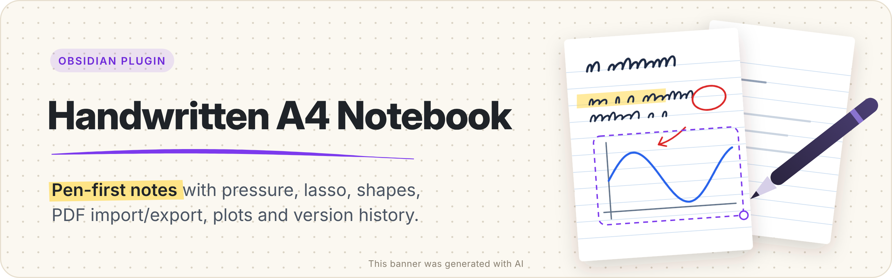
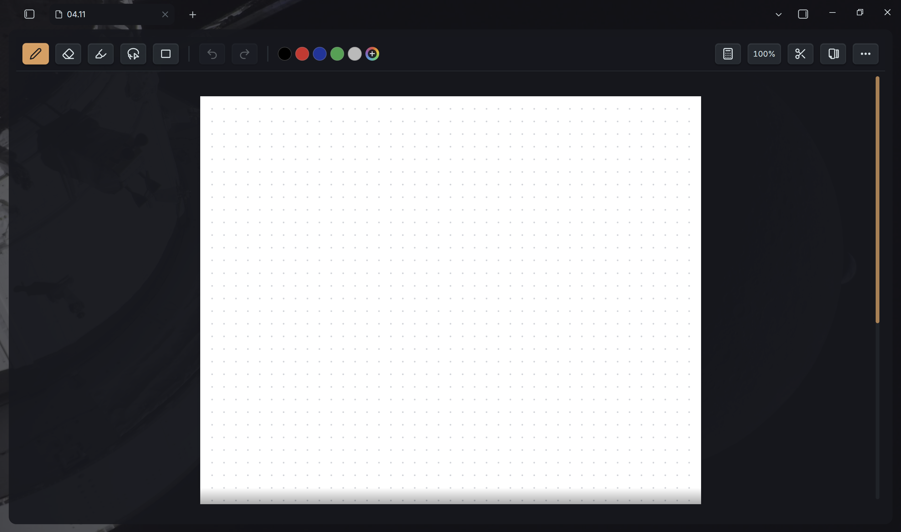
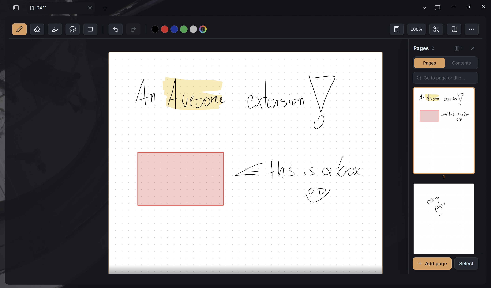
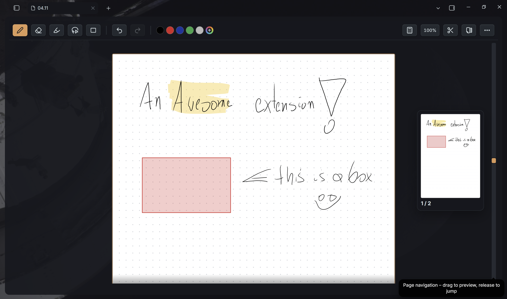
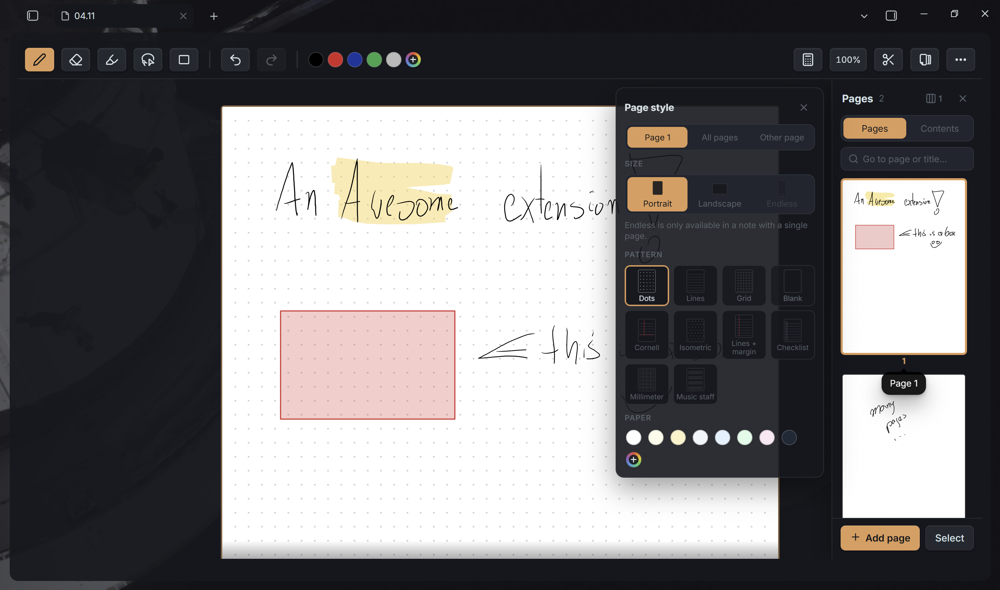
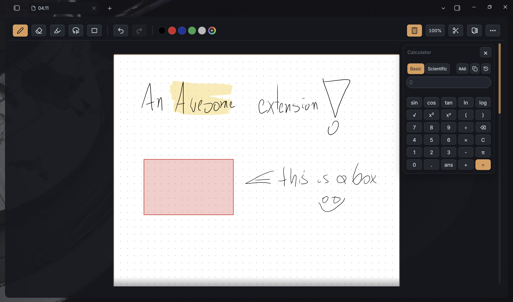
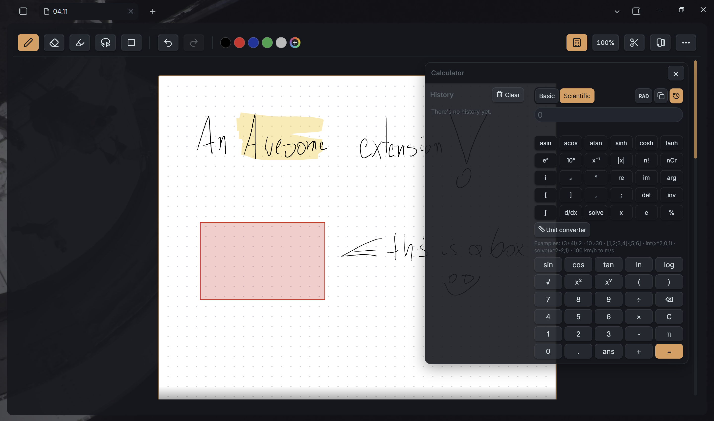
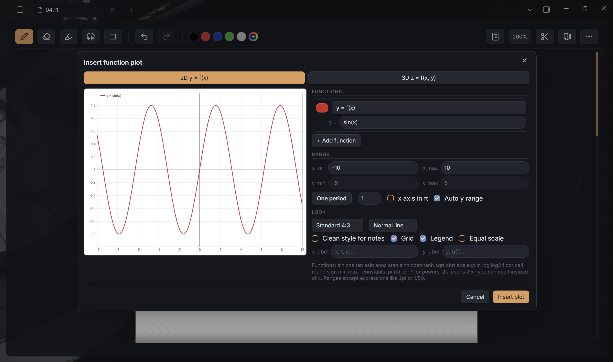

<p align="center"></p>

# Handwritten A4 Notebook

**[✏️ Try the live demo](https://handwriting.anulab.tech/demo/)** – the real plugin running in your browser, no installation needed. · [Website](https://handwriting.anulab.tech/)

> **AI Notice!** This project is entirely vibe-coded using Claude Code.
>
> It started as a personal tool, made just for me and my own notes. Over time it grew into something
> complete and useful enough that I decided to share it. Expect a few rough edges - feedback and bug reports are welcome.

Write by hand on real pages - portrait, landscape or one endless page. Pen pressure, highlighter, shapes,
lasso selection, images, imported PDFs, function plots, a calculator, a pages panel, version history, PDF export and
printing - in notes that stay readable even without Obsidian.
<!--
## Gallery 
<p align="center">
  
  
  
   
  
  
  
</p>
-->

## Contents
- [Getting started](#getting-started)
- [Writing tools](#writing-tools)
- [Selection](#selection)
- [Moving around: scroll, zoom, page rail](#moving-around-scroll-zoom-page-rail)
- [Pages panel](#pages-panel)
- [Page style: size, pattern, paper](#page-style-size-pattern-paper)
- [Page titles and contents](#page-titles-and-contents)
- [Images, screenshots and PDFs](#images-screenshots-and-pdfs)
- [Calculator and function plots](#calculator-and-function-plots)
- [Export to PDF and printing](#export-to-pdf-and-printing)
- [Version history](#version-history)
- [Where your data lives](#where-your-data-lives)
- [PDF without Obsidian - `hnote2pdf.py`](#pdf-without-obsidian---hnote2pdfpy)
- [Toolbar and the ⋯ menu](#toolbar-and-the--menu)
- [Pen, touch and palm rejection](#pen-touch-and-palm-rejection)
- [OLED care](#oled-care)
- [Commands](#commands)
- [Keyboard shortcuts](#keyboard-shortcuts)
- [Settings overview](#settings-overview)
- [Installation](#installation)
- [Privacy, network and desktop-only features](#privacy-network-and-desktop-only-features)
- [For developers](#for-developers)
- [License](#license)

## Getting started
1. **New note:** right-click a folder in the file explorer → **New handwritten note**, or run the command
   *Create new handwritten note*. The name is built from the folder and today's date (configurable).
2. **Write** with the pen (or the mouse). Fingers scroll and zoom, the pen draws.
3. Everything saves automatically. Notes are `.hnote` files - plain JSON.

## Writing tools
| Tool | Description |
|---|---|
| **Pen** | Pressure-sensitive ink with three thicknesses, a colour palette and opacity (100 / 75 / 50 / 25 %). Pen jitter is smoothed out, sharp corners stay sharp. |
| **Highlighter** | Transparent marker with flat ends, like a real highlighter. Overlapping strokes don't get darker, and the turns of a zig-zag over several lines stay square. |
| **Eraser** | Cuts strokes where you rub (it doesn't paint white). Its size on screen is the same at every zoom level; rub quickly and it grows up to 4×. The pen's eraser end and side button work too. You choose whether it erases shapes, and whether it leaves the highlighter alone, removes whole highlighter strokes or only the part you rub over. |
| **Shapes** | Line (optionally with an arrow), rectangle, ellipse. Solid, dashed, dotted or dash-dot lines. Fill: outline only, solid, light (semi-transparent) with outline, or light fill only. Hold **Shift** for straight angles, squares and circles. |
| **Selection** | Freehand lasso or rectangle. Select, move, scale, rotate, recolour, group and lock. |

**Tap the active tool again** for its options: thickness (pen, highlighter, eraser, shapes), opacity (pen),
what the eraser erases, the shape options, or the selection mode (lasso / rectangle - and the thickness of the
selected strokes). Colours sit on the toolbar; in a narrow window they are in one panel under the colour button.

## Selection
- **Draw around** strokes and images to select them, or **tap** a stroke or image (it is selected with its whole group).
- **Drag** the selection to move it - also onto another page. **Corner handle**: scale. **Round handle**: rotate (Shift = 15° steps).
- With strokes selected, the palette changes their colour; tap the selection tool again for their thickness.
- **Selection options** (toolbar button or right-click the selection): group / ungroup, lock, bring to front /
  send to back, align, rotate 90°, duplicate, copy, cut, delete.
- Locked items can't be selected, moved or erased - right-click the page → *Unlock*.

## Moving around: scroll, zoom, page rail
- **Fingers / trackpad:** one finger scrolls (with inertia), two fingers pinch-zoom. **Mouse:** wheel scrolls, Ctrl + wheel zooms.
- **Zoom button** (shows the current zoom, e.g. *135%*): − / + in 10 % steps, *Fit width*, *100%*, and up to four
  **favourite zoom levels** - save the zoom you like to write at, one tap brings it back. *Open notes at …* makes every
  note open at that zoom (otherwise each note keeps its last zoom).
- Notes remember **where you stopped** and open at that place.
- The **current page** has a thin accent frame (the same at every zoom level).
- **Page rail** - a thin strip along the edge of the note, like a scrollbar: top = first page, bottom = last page,
  ticks = pages with a title. **Drag along it** to see a preview of the page under your finger (*74 / 120* and the
  section title); let go to jump there. A tap jumps at once. A frame on the preview shows which part of the page
  you will land on (the top of the page, or - when you are zoomed in on a long page - the place you point at).
  - *Fine* precision (default): move your finger away from the edge and the rail slows down 4× - handy with hundreds
    of pages - and the preview snaps to section starts. *Simple* follows your finger 1:1.
  - Settings → Pages and view → Page navigation: always visible / while scrolling / off, side, precision.
- In a very narrow window the toolbar scrolls sideways (finger, mouse wheel or the ‹ › arrows).

## Pages panel
The **Pages** button on the toolbar (also ⋯ → *Pages panel*, or right-click / long-press a page) opens thumbnails of all
pages. The panel lies over the note on the right or left (Settings → Pages and view); on a phone it slides up from the bottom.
- **Sections:** pages are grouped by page titles; tap a section header to fold it. The search field jumps to a page
  number or filters by title.
- **Tap** a thumbnail to go to the page. **Drag** it (mouse) or **long-press and drag** it (finger / pen) to move it.
- **Long-press / right-click** a thumbnail: add page before / after, duplicate, set title, page style, move to…, delete.
- **Select** several pages, then *Style*, *Duplicate*, *Move to…* or *Delete*.
- **+ Add page** adds a page at the end.
- **Contents** tab: the titled pages as a list.
- **Columns:** 1, 2 or 3 - the button at the top of the panel, or Settings → Pages and view.
- Changes apply at once. Every add / move / delete can be undone from the **Undo** message, and deleting pages first
  saves a version to the version history.

## Page style: size, pattern, paper
Open it from the ⋯ menu (*Page style…*), by right-clicking / long-pressing a page, from the pages panel or with a
toolbar shortcut. It opens at the side of the view. At the top choose which pages it changes: **this page**,
**all pages** (the note default, also used for new pages), **another page**, or the **selected pages** in the panel.
- **Size:** *Portrait* (A4), *Landscape* (A4), or *Endless* - one page that grows downwards as you write
  (half a page at a time, up to 16 A4 pages). Endless is for one-page notes only, so such a note can't get more pages.
- **Pattern:** dots, lines, grid (5 mm), blank, Cornell, isometric, lines + margin, checklist, millimetre paper, music staff.
- **Paper colour:** presets or any colour.
- *Use note default* removes the pages' own style.

## Page titles and contents
Give important pages a title: right-click a page → **Page title…**, the pages panel, or the command
*Set title of the current page*.
- Titled pages start sections in the pages panel, are ticks on the page rail and are listed in the **Contents** tab.
- **Go to page…** (command) searches titles and page numbers.
- Titles become **bookmarks** in exported PDFs.

## Images, screenshots and PDFs
- **Paste** (Ctrl+V), **drag & drop**, or **⋯ → Insert image…**. Images can be moved, scaled, rotated and cropped
  (right-click the image → *Crop image…*).
- **Screenshot** (Windows): starts the Snipping Tool and inserts the capture automatically.
- **Import PDF:** each PDF page becomes a page of the note with the PDF as its background - write on lecture slides,
  worksheets or papers. Landscape PDF pages become landscape pages. Uses the PDF engine built into Obsidian (offline).

## Calculator and function plots
- **Calculator** (toolbar button or command): a compact *Basic* tab and a *Scientific* tab with complex numbers,
  matrices, integrals, derivatives, equation solving and a unit converter. Click a result to copy it.
- **Function plot** (⋯ menu or command): functions, parametric and polar curves, or data points with a fitted curve.
  Options include *One period*, π-based axis ticks, a clean style without a grid and size presets.
  Plots are inserted as images and stay **editable** (right-click → *Edit plot*).

## Export to PDF and printing
- **⋯ → Export to PDF** (or the command). Choose where to save it each time, or set a default: next to the note, a vault
  folder, or - on desktop - a folder on your computer. Page sizes, patterns, images and PDF backgrounds are kept; page
  titles become bookmarks. Resolution: Settings → Files and export.
- **⋯ → Print…** (or the command / a toolbar shortcut). On desktop the system print dialog opens with one sheet per page
  (A4 portrait or landscape as in the note, endless pages cut into A4 sheets). On phones and tablets plugins can't open
  a print dialog, so the note is exported to PDF and you print it from your PDF viewer (Share → Print).

## Version history
Versions are saved automatically: while you work (at most every N minutes), when you close the note, before pages are
deleted and before an older version is restored. The same content is never stored twice, and empty notes are not stored.

**⋯ → Version history…** shows the versions by day with a page preview. **Restore** a version (the current state is
kept, so the restore can be undone), **open it as a copy**, **save a version now**, or **delete** single versions or all
of them (each delete needs a second click). The last 24 hours keep every version; older days keep the last one of each
day. Retention time and a size limit per note: Settings → Version history.

## Where your data lives
```
Lectures/Physics/Lecture 1.hnote                  ← the note (JSON)
Lectures/Physics/.Lecture 1.hnote-data/           ← hidden folder of this note
    attachments/        images, plots, imported PDF pages used by the note
    history/            versions (gzip) + history/attachments (images only old versions use)
    meta.json
```
- The hidden folder **moves, renames and deletes together with the note**. The note plus its folder contain everything.
- Images the note no longer uses move to `history/attachments` (old versions still show them) and are removed when no
  version needs them anymore.
- Prefer Obsidian's attachment folder? Settings → Files and export → *Where to keep pasted images and PDF pages*.
  Note: some sync services (e.g. Obsidian Sync) skip hidden folders.

## PDF without Obsidian - `hnote2pdf.py`
A small Python script turns `.hnote` notes into vector PDFs on any computer - no Obsidian, no plugin, no extra packages
(Python 3.8+; Pillow optional for faster PNGs and WebP/GIF images).
1. Settings → Files and export → **Save hnote2pdf.py** (written to the root of your vault), or the command
   *Copy command to convert this note to PDF with Python*, which copies a ready-to-paste terminal command.
2. Run it:
```bash
python3 hnote2pdf.py "Lectures/Physics/Lecture 1.hnote"          # → Lecture 1.pdf next to the note
python3 hnote2pdf.py "Lecture 1.hnote" -o ~/Desktop/lecture.pdf
python3 hnote2pdf.py MyVault -r -o ~/PDF/                         # every note in a folder, recursively
python3 hnote2pdf.py ".Lecture 1.hnote-data/history/20261019-212953_0f315cad_auto.hnote.gz"   # an old version
```
Options: `--no-pattern` (plain paper), `--pressure 0.7` / `--no-pressure`, `--vault PATH`.
The file format is documented at the top of the script and in [`src/tools/README.md`](src/tools/README.md).

## Toolbar and the ⋯ menu
Settings → **Toolbar** decides what sits on the toolbar:
- **Tools** - eraser, highlighter, selection, shapes, undo / redo: tap a chip to show or hide it. The pen and the
  colours always stay.
- **Shortcut buttons** - calculator, zoom, contents, function plot, insert image, pages panel, page style, screenshot,
  import / export PDF, print, version history, fit to width. Buttons on the toolbar can be reordered (‹ ›) and removed
  (×); the rest can be added from *Available*.

Anything that isn't on the toolbar is in the **⋯ menu** - nothing appears twice. The ⋯ menu also has quick switches
(page rail, pen pressure, palm rejection) and *Settings*.

## Pen, touch and palm rejection

- **Pen pressure** on / off and strength.
- **Palm rejection:** *Auto* ignores touch while the pen is near the screen or just after it was used, and ignores
  large contacts. *Strict* - fingers never scroll (pen only).
- **Pinch to zoom** - two fingers zoom as soon as they clearly move apart / together (also with one finger held still);
  two contacts moving together (a sliding hand) only scroll, three or more contacts (a resting hand) do nothing, and
  fingers are ignored while the pen is at the screen. Turn it off completely if you prefer.
- **Long-press menu** - hold a finger still to open the page menu (turn it off if a resting hand triggers it).
- **Pen side button:** page menu, undo, redo, Snipping Tool (Windows) or nothing.

## OLED care
Settings → **OLED care** - each option on its own:
- **Dark paper on screen** - light pages are shown dark with light ink (colours keep their hue). Display only: files and
  exports are unchanged.
- **Fade the toolbar while writing** - the toolbar and the page rail fade and come back when the pen or cursor gets close.
- **Pixel shift** - the view moves by 1-2 px every few minutes.
- **Dim when idle** - after 1-30 minutes without input the note dims almost to black; the first tap only wakes it.

## Commands
| Command | Notes |
|---|---|
| Create new handwritten note | |
| Open calculator | |
| Insert function plot into handwritten note | |
| Export current note to PDF / Print current note | |
| Show version history of the current note / Save a version of the current note now | |
| Go to page… (search page titles) / Set title of the current page | |
| Zoom to favourite zoom (repeat to cycle) / Save current zoom as favourite | |
| Move images of the current note into its hidden folder | for notes created before the hidden folder existed |
| Remove unused images from the current note's hidden folder | |
| Save the PDF converter script / Copy command to convert this note to PDF with Python | |

## Keyboard shortcuts
| Keys | Description |
|---|---|
| Ctrl/Cmd + Z, Ctrl/Cmd + Y | undo, redo |
| Ctrl/Cmd + C / X / V | copy / cut / paste the selection or an image |
| Delete / Backspace | delete the selection |
| Escape | clear the selection; close the page style panel / pages panel |
| Ctrl/Cmd + mouse wheel | zoom |
| Shift while drawing a shape / rotating | straight angles, squares, circles / 15° steps |

## Settings overview
| Section | What you can set |
|---|---|
| Pen and touch | pressure, palm rejection, pinch to zoom, long-press menu, pen side button, what the eraser erases, default selection mode |
| Colors | five quick colours for the pen and for the highlighter |
| Pages and view | default page pattern and paper colour, favourite zoom levels, zoom when opening a note, page rail (visibility, side, precision), pages panel (side, columns) |
| Toolbar | tools and shortcut buttons on the toolbar (the rest goes to ⋯) |
| Files and export | where images are stored, the Python converter, new-note naming, PDF export location and resolution |
| Version history | on / off, interval, how long to keep versions, space limit per note |
| Performance | canvas sharpness (lower = smoother on slow devices) |
| OLED care | dark paper, fading toolbar, pixel shift, dim when idle |
| Advanced | debug logging (developer console) |

## Installation
**From Community plugins:** Settings → Community plugins → Browse → search *Handwritten A4 Notebook* → Install → Enable.

**Beta via BRAT:** install the *BRAT* plugin → *Add beta plugin* → `<github-user>/<repository>`.

**Manually:** download `main.js`, `manifest.json` and `styles.css` from the latest release into
`<your vault>/.obsidian/plugins/handwritten-notebook/`, then enable the plugin in Settings → Community plugins.

## Privacy, network and desktop-only features
- The plugin doesn't make network requests or collect telemetry. PDF import uses the PDF engine bundled with Obsidian.
- **Files outside the vault:** only when you choose a folder on your computer as the PDF export location (desktop only).
- **Desktop-only extras** (Electron / Node APIs, used only on desktop and turned off on mobile): saving PDFs to a folder
  outside the vault, the Windows Snipping Tool integration, and reading images from the system clipboard when the
  browser clipboard is not available. Everything else works on desktop, tablets and phones.
- **Vault file list:** the plugin lists the files in your vault only to find other `.hnote` notes (so a renamed note
  doesn't take over another note's hidden folder, and an image moved into a note's folder isn't deleted while another
  note still uses it) and to offer vault folders as a PDF export location. It reads only `.hnote` files, never your
  Markdown notes.
- **Clipboard:** used only when you ask for it - copying / pasting strokes and images, pasting a screenshot, copying a
  calculator result or the `hnote2pdf.py` command. Nothing is read from the clipboard in the background, except while
  waiting for a Snipping Tool screenshot you started.
- Inside your vault the plugin writes only the `.hnote` files, their hidden `.<name>.hnote-data` folders and - when you
  ask for it - `hnote2pdf.py` in the vault root.

## For developers
```
src/main.ts             plugin + the view (lifecycle, loading / saving notes)
src/styles.css          all styles
src/view/*.ts           view features as mixins (input, navigation, selection, pageRail, pagesPanel, toolbar, versions, …)
src/format.ts           file format versions and migrations (v1 → v4)
src/pageFormat.ts       page sizes (A4, landscape, endless)
src/templates.ts        page patterns (shared geometry for screen, thumbnails, PDF)
src/math/               calculator, expression parser, units, function plots
src/tools/hnote2pdf.py  standalone converter; src/tools/embed_script.py copies it into src/converterScript.ts
scripts/                esbuild.config.mjs (build) and deploy.mjs (copies the build into a vault for testing)
build/                  build output: main.js, manifest.json, styles.css (not committed)
manifest.json           plugin manifest – stays in the repository root, Obsidian reads it from there
.github/workflows/      release.yml: GitHub release on a version tag · pages.yml: the website on GitHub Pages
site/                   website + live demo: content.mjs (all texts and links), render.mjs, site.css, shim/ (fake Obsidian API)
```
```bash
npm install
npm run dev           # build into build/ and rebuild on change
npm run build         # production build into build/
npm run typecheck     # TypeScript check
npm run embed         # after changing src/tools/hnote2pdf.py
npm run deploy:local  # build and copy build/* into the vault folder set in .vault-plugin-dir
npm run site:dev      # website + live demo on http://localhost:8080 (rebuilds on change)
npm run site:build    # website into build/site/
```

## License
[MIT License](LICENSE) - free to use, change and share, also commercially, as long as the copyright notice
(with the link to this repository) and the license text are kept in all copies.
